<div align="center">

# ClinicQ

**Book the slot, watch the queue.**
A clinic appointment and live-queue app, taken from a git commit to a monitored Kubernetes deployment on AWS with a full DevOps pipeline.

[](https://github.com/Samarth1-glitch/ClinicQ/actions/workflows/ci-cd.yml)


[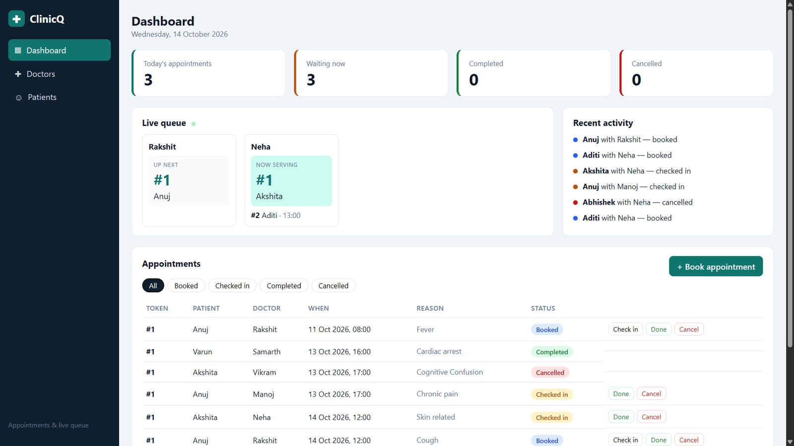](docs/demo.mp4)

### [▶ Watch the demo video](docs/demo.mp4) &nbsp;·&nbsp; [📑 Open the presentation](docs/ClinicQ-Capstone.pptx)

</div>

---

## Contents

1. [What ClinicQ does](#1-what-clinicq-does)
2. [Results at a glance](#2-results-at-a-glance)
3. [How it works](#3-how-it-works)
4. [Tech stack](#4-tech-stack)
5. [Run it locally](#5-run-it-locally)
6. [API](#6-api)
7. [Data model and database](#7-data-model-and-database)
8. [Automated tests](#8-automated-tests)
9. [Containers](#9-containers)
10. [Development workflow](#10-development-workflow)
11. [CI/CD pipeline](#11-cicd-pipeline)
12. [Security scanning with Trivy](#12-security-scanning-with-trivy)
13. [Infrastructure with Terraform](#13-infrastructure-with-terraform)
14. [Kubernetes with Helm](#14-kubernetes-with-helm)
15. [Ingress, autoscaling and storage](#15-ingress-autoscaling-and-storage)
16. [Monitoring](#16-monitoring)
17. [Troubleshooting labs](#17-troubleshooting-labs)
18. [Problems I hit and how I fixed them](#18-problems-i-hit-and-how-i-fixed-them)
19. [Cost control and clean-up](#19-cost-control-and-clean-up)
20. [Project structure](#20-project-structure)
21. [Requirement map](#21-requirement-map)

---

## 1. What ClinicQ does

Small clinics often run on paper tokens and a receptionist's memory. ClinicQ puts **booking** and the **waiting line** on one screen.

- **Book** an appointment with a doctor for a time slot.
- **Check in** a patient on arrival. Each appointment carries a **token number, counted per doctor per day**, so every doctor has their own line.
- Move every visit through **booked → checked in → completed**, or **cancelled**.
- Booking the same doctor and slot twice is refused with **HTTP 409**.
- The **live queue** shows who is *now serving* and who is *up next* for each doctor, and the dashboard shows today's totals and recent activity.


*The running app: stat cards, the live queue per doctor, recent activity, and the appointment table with Check in, Done and Cancel actions. Every doctor's first patient is token #1.*

---

## 2. Results at a glance

| | |
|---|---|
| **24** | automated tests, all passing in about 1.5 seconds |
| **3 m 40 s** | from `git push` to the new version running on EKS (full pipeline, run #17) |
| **61** | AWS resources created and later removed by a single Terraform run |
| **5 pods** | Running on EKS: 2 backend, 2 frontend, 1 PostgreSQL, zero restarts |
| **2 / 2** | backend pods scraped and `UP` in Prometheus |
| **0** | manual steps to deploy a change once the platform exists |

---

## 3. How it works

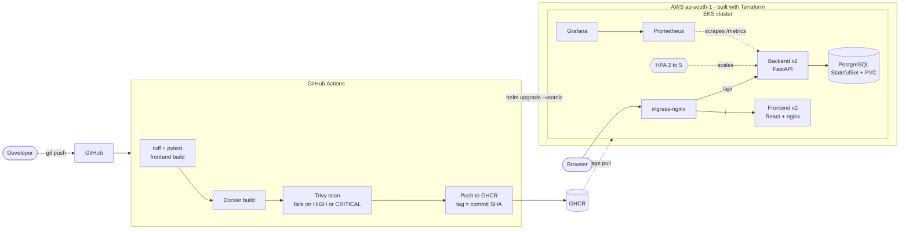

**The idea:** the pipeline is the only path to the cluster. A push to `main` runs the tests, builds both images, scans them, pushes them tagged with the commit SHA, and deploys exactly that SHA with Helm. Terraform builds the platform underneath once.

---

## 4. Tech stack

| Layer | Technology |
|---|---|
| Frontend | React 18, Vite, served by unprivileged nginx |
| Backend | FastAPI, SQLAlchemy 2, Pydantic, Alembic |
| Database | PostgreSQL 16 |
| Quality | pytest on in-memory SQLite, ruff |
| Packaging | Docker, multi-stage builds, non-root users |
| CI/CD | GitHub Actions, GitHub Container Registry, Trivy |
| Infrastructure | Terraform: VPC and EKS 1.34 on Spot nodes |
| Deployment | Helm chart, ingress-nginx, metrics-server, HPA |
| Observability | Prometheus (kube-prometheus-stack), Grafana |

---

## 5. Run it locally

**Prerequisite:** Docker Desktop running.

```bash
git clone https://github.com/Samarth1-glitch/ClinicQ.git
cd ClinicQ
docker compose up --build
```

| What | URL |
|---|---|
| App | http://localhost:3000 |
| Interactive API docs | http://localhost:8000/docs |
| Health | http://localhost:8000/health |
| Prometheus metrics | http://localhost:8000/metrics |

Optional demo data (Git Bash, WSL or any bash shell):

```bash
./scripts/seed.sh http://localhost:8000
```

Start again from an empty database:

```bash
docker compose down -v
```

The compose logs show the browser calling the frontend on port 3000, and nginx proxying every `/api` request to the backend, which answers `200 OK`:

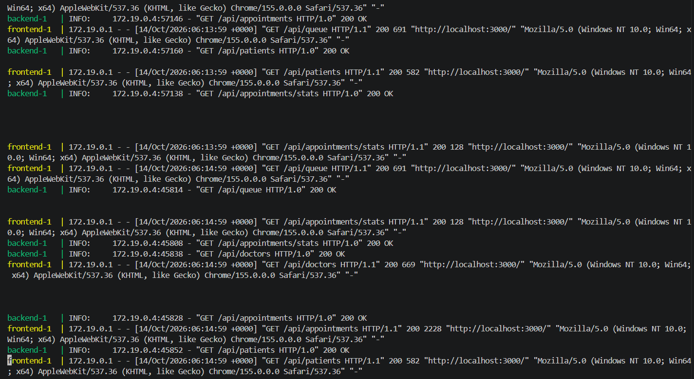

---

## 6. API

All routes live under `/api`. FastAPI generates interactive documentation at **`/docs`**.

| Resource | Endpoints |
|---|---|
| Doctors | `GET /doctors`, `POST /doctors`, `GET` `PUT` `DELETE /doctors/{id}` |
| Patients | `GET /patients`, `POST /patients`, `GET` `PUT` `DELETE /patients/{id}` |
| Appointments | `GET /appointments`, `POST /appointments`, `GET` `PUT` `DELETE /appointments/{id}` |
| Dashboard | `GET /appointments/stats` |
| Live queue | `GET /queue` |
| Operations | `GET /health`, `GET /ready`, `GET /metrics` |

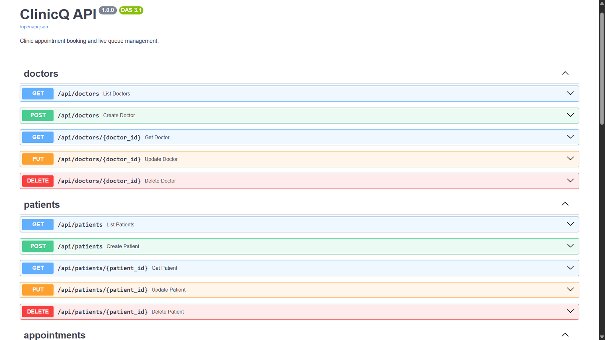

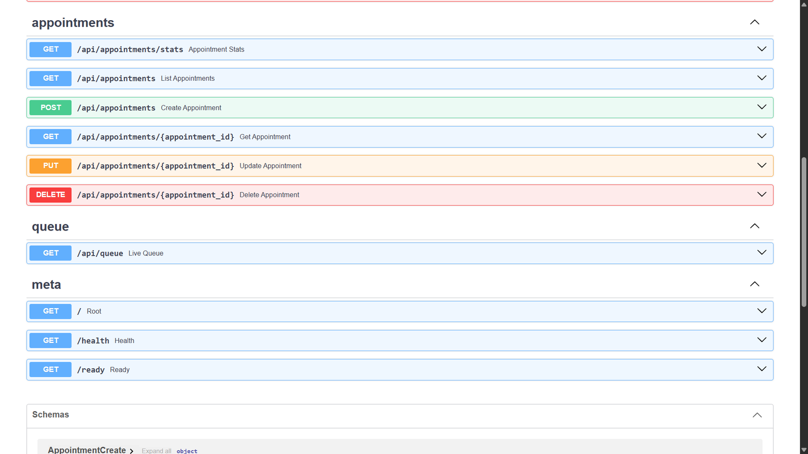

---

## 7. Data model and database

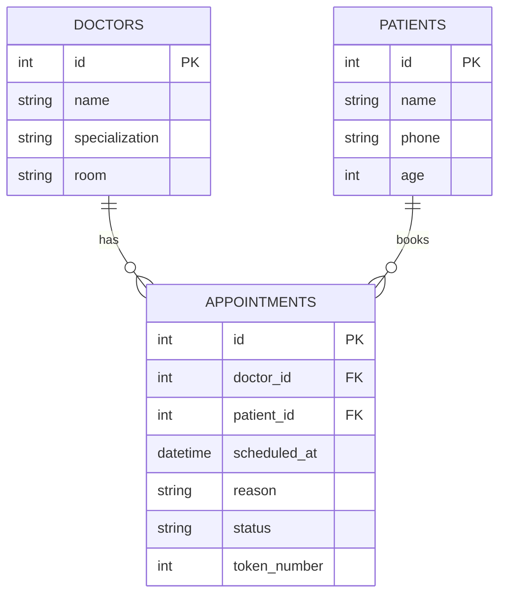

- **Alembic** manages the schema. Migration `0001` creates the tables and `0002` adds indexes on `scheduled_at` and `(doctor_id, scheduled_at)` for the queue and schedule lookups.
- Migrations run under a PostgreSQL **advisory lock**, so two pods starting together cannot migrate at the same time.
- Status changes are validated in code: `booked → checked_in → completed`, with `cancelled` reachable before completion.

The data really lives in PostgreSQL. Querying the appointments table from the running container shows every status, and the `token_number` restarting at 1 for each doctor:

```bash
docker compose exec postgres psql -U clinicq -c "select * from appointments;"
```

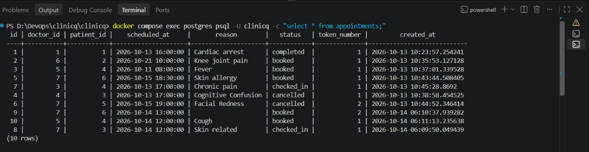

---

## 8. Automated tests

```bash
cd backend
python -m venv .venv
.venv\Scripts\activate            # Windows   (Linux/macOS: source .venv/bin/activate)
pip install -r requirements-dev.txt
ruff check .
pytest -v
```

**24 tests** cover doctors, patients, appointments, the live queue, health endpoints and the migrations. They run on in-memory SQLite, so the pipeline needs no database service.

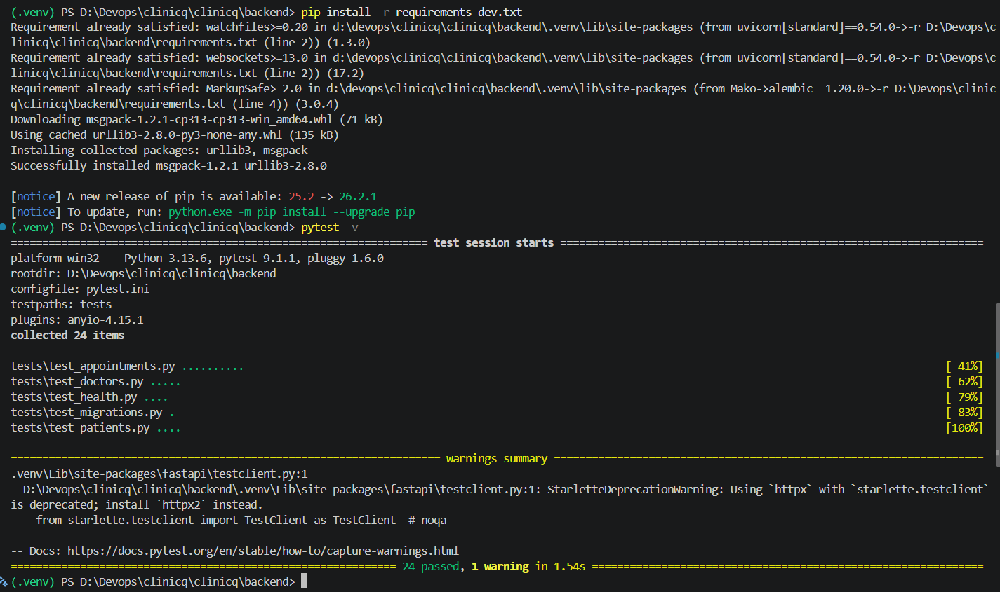

---

## 9. Containers

| Image | Highlights |
|---|---|
| **backend** | Python 3.12 slim, runs as **UID 10001**, applies migrations on start, and `pip`, `setuptools` and `wheel` are removed from the final image |
| **frontend** | Multi-stage build (Node builds the bundle, nginx serves it), `nginx-unprivileged` on port 8080, proxies `/api/` to `BACKEND_URL` |

Both run as non-root so Kubernetes can enforce `runAsNonRoot`.

---

## 10. Development workflow

The project was built in small, focused commits using conventional commit prefixes (`feat`, `build`, `test`, `ci`, `infra`, `deploy`, `ops`), so the history reads as the story of the build: API first, then tests, containers, the pipeline, Terraform, Helm and monitoring.

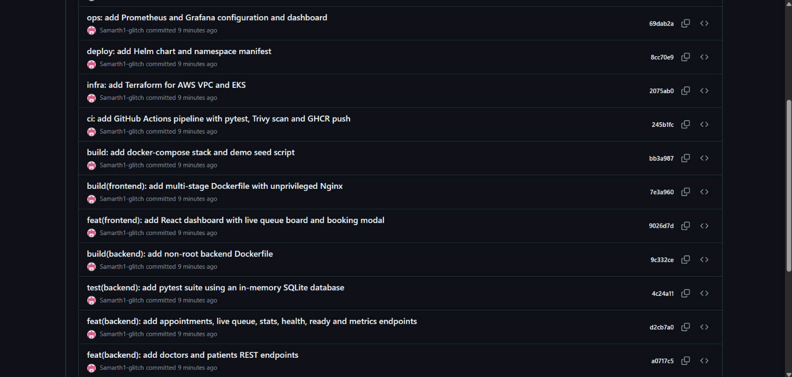

---

## 11. CI/CD pipeline

Defined in [`.github/workflows/ci-cd.yml`](.github/workflows/ci-cd.yml).

| Job | What it does |
|---|---|
| **Test** | `ruff`, `pytest` and the frontend build |
| **Terraform validate** | `terraform init -backend=false` and `terraform validate` |
| **Helm lint** | `helm lint` and a template render with default and dev values |
| **Build, scan and push** | Matrix of `backend` and `frontend`: build, **Trivy gate**, then push to GHCR tagged with the **commit SHA** |
| **Deploy to EKS with Helm** | Installs ingress-nginx and metrics-server if missing, then runs `helm upgrade --install --atomic`. Runs only when `DEPLOY_ENABLED` is `true` |

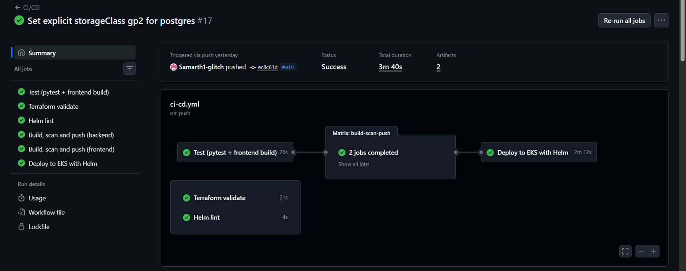

*Run #17: every job is green, including **Deploy to EKS with Helm**, in 3 m 40 s. The deploy job alone took 2 m 12 s.*

### Settings the deploy job uses

| Type | Name | Purpose |
|---|---|---|
| Variable | `DEPLOY_ENABLED` | `true` switches the EKS deploy job on |
| Variable | `EKS_CLUSTER_NAME` | Defaults to `clinicq-eks` |
| Variable | `AWS_REGION` | Defaults to `ap-south-1` |
| Variable | `SERVICE_MONITOR_ENABLED` | `true` once Prometheus is installed |
| Secret | `AWS_ACCESS_KEY_ID`, `AWS_SECRET_ACCESS_KEY` | Credentials for the deploy job |

### Images and tags

Images are pushed to GitHub Container Registry **only after the scan passes**:

```
ghcr.io/samarth1-glitch/clinicq-backend:<commit-sha>
ghcr.io/samarth1-glitch/clinicq-frontend:<commit-sha>
```

There is no `latest` tag. Every running pod maps to exactly one commit, a rollback is a Helm deploy of an older SHA, and the image that was scanned is the image that runs.

---

## 12. Security scanning with Trivy

Each image is scanned inside the pipeline. The job **fails on any fixable HIGH or CRITICAL finding**, and the push step comes after the scan, so a vulnerable image never reaches the registry.

```bash
docker run --rm -v /var/run/docker.sock:/var/run/docker.sock aquasec/trivy:0.75.0 \
  image --severity HIGH,CRITICAL --ignore-unfixed --exit-code 1 <image>:<sha>
```

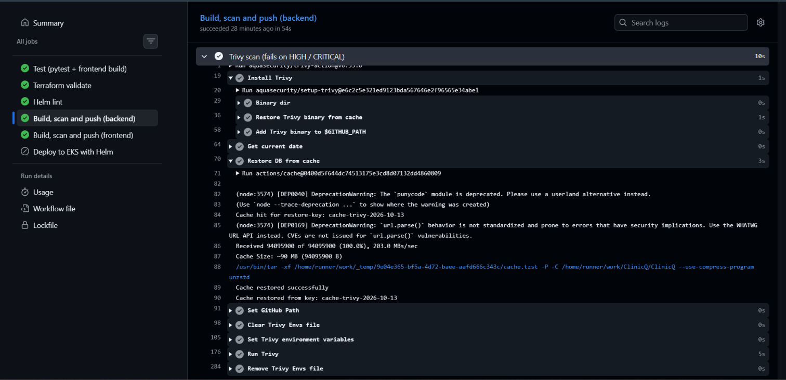

**What the first scan found:** HIGH findings inside libraries bundled with `pip`, not in the application code. The app does not need `pip` at runtime, so the Dockerfile now uninstalls `pip`, `setuptools` and `wheel` after installing requirements, and the scan is clean.

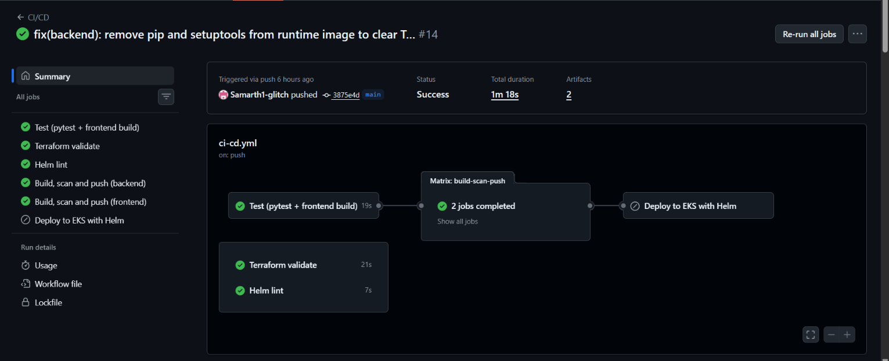

*Run #14, the fix commit: "remove pip and setuptools from runtime image". Every gate is green.*

---

## 13. Infrastructure with Terraform

The [`terraform/`](terraform) folder builds the AWS platform:

- A **VPC** with 2 public and 2 private subnets across two availability zones, and a **single NAT gateway** to keep cost down
- An **EKS 1.34** cluster in `ap-south-1`
- A managed node group on **Spot** instances
- The **EBS CSI** addon wired through IRSA, so PostgreSQL can get a volume

```bash
cd terraform
copy terraform.tfvars.example terraform.tfvars     # Linux/macOS: cp
terraform init
terraform plan -out tfplan
terraform apply tfplan
aws eks update-kubeconfig --region ap-south-1 --name clinicq-eks
```

Credentials come from `aws configure` or environment variables, never from a file in the repository.

**1. Initialise**

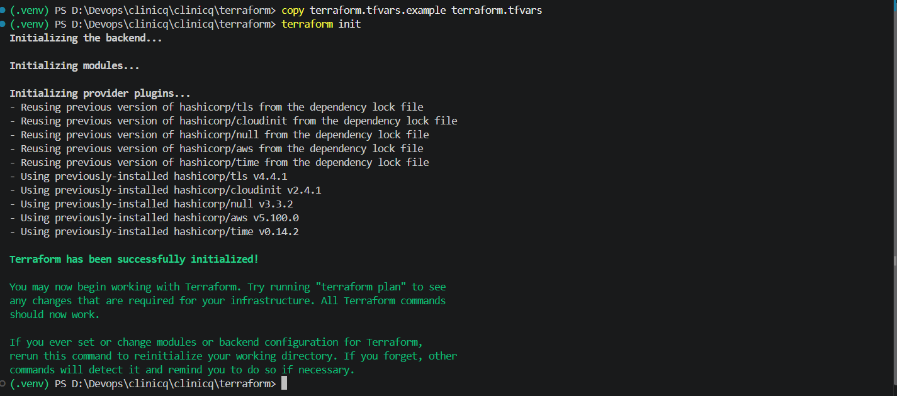

**2. Apply, and read the outputs.** The `configure_kubectl` output is the exact command that connects `kubectl` to the new cluster.

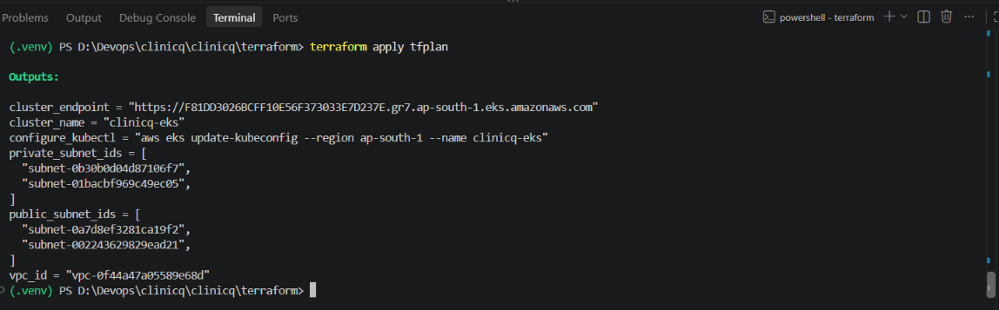

**3. Check the result in the AWS console.** The network:

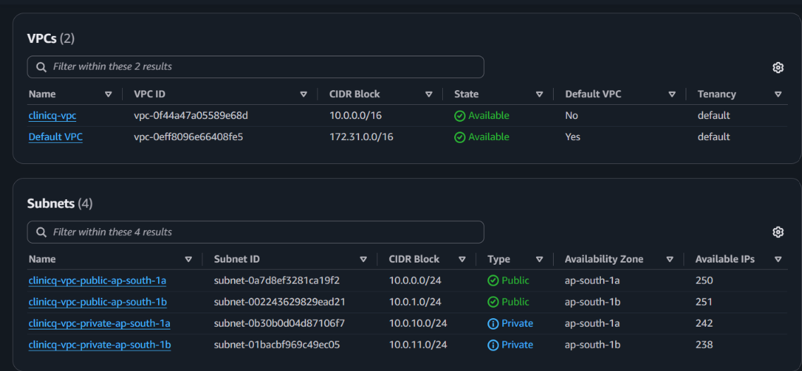

The cluster and node group, both `ACTIVE`, Kubernetes 1.34, capacity type `SPOT`:

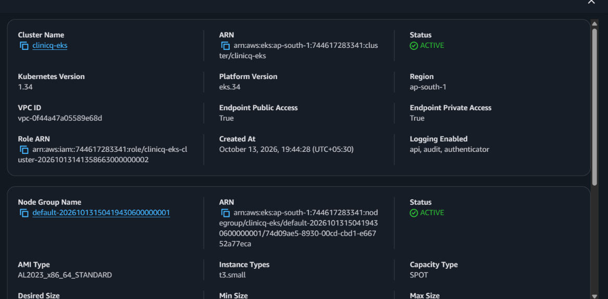

---

## 14. Kubernetes with Helm

The chart in [`helm/clinicq`](helm/clinicq) deploys everything:

| Resource | Details |
|---|---|
| Backend | 2 replicas, `ClusterIP` service, liveness and readiness probes, resource requests and limits, `runAsNonRoot` |
| Frontend | 2 replicas, `ClusterIP` service, probes, resource limits, `runAsNonRoot` |
| PostgreSQL | StatefulSet with a persistent volume claim and probes, credentials in a Kubernetes **Secret** |
| Ingress | `/` to the frontend, `/api` to the backend |
| HPA | Backend scales between 2 and 5 pods at 60% CPU |
| ServiceMonitor | Optional, switched on once Prometheus is installed |

The pipeline deploys automatically. The same release by hand:

```bash
helm upgrade --install clinicq ./helm/clinicq \
  --namespace clinicq --create-namespace \
  --set backend.image.repository=ghcr.io/samarth1-glitch/clinicq-backend \
  --set backend.image.tag=<commit-sha> \
  --set frontend.image.repository=ghcr.io/samarth1-glitch/clinicq-frontend \
  --set frontend.image.tag=<commit-sha> \
  --atomic --wait --timeout 10m
```

`--atomic` rolls the release back automatically if the rollout fails.

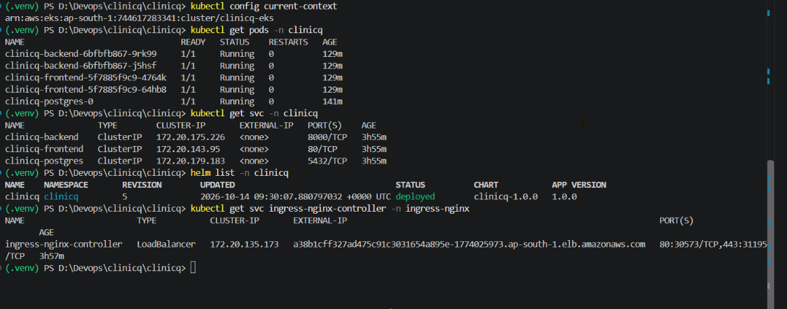

*On EKS: five pods `Running` with zero restarts, three `ClusterIP` services, Helm revision 5 with status `deployed`, and the ingress controller's AWS load balancer address.*

### Rehearsal on a local cluster (kind)

The same chart runs on a free local Kubernetes cluster, which is how the deployment was rehearsed before spending any AWS money:

```bash
bash scripts/setup-kind.sh        # creates the kind cluster and installs ingress-nginx and metrics-server
helm upgrade --install clinicq ./helm/clinicq -n clinicq --create-namespace -f helm/clinicq/values-dev.yaml
```

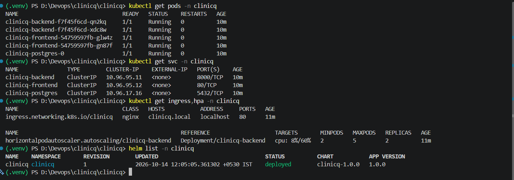

*Local cluster: five pods, three services, the `clinicq.local` ingress, and the HPA reading `cpu: 8%/60%` with min 2, max 5.*

---

## 15. Ingress, autoscaling and storage

**Ingress.** `ingress-nginx` creates one AWS load balancer. The browser only talks to that address: requests for `/` go to the frontend service on port 80 and requests under `/api` go to the backend service on port 8000. Page and API share one origin, so no CORS configuration is needed.

**Autoscaling.** The backend HPA keeps 2 pods and scales up to 5 when average CPU passes 60% of the requested CPU, using `metrics-server`.

```
desired replicas = ceil( current replicas x current usage / target usage )
```

To trigger it, run the load test (it starts a load-generator pod inside the cluster) and watch the replicas:

```bash
./scripts/load-test.sh              # Ctrl+C to stop
kubectl get hpa -n clinicq -w       # in a second terminal
```

**Storage.** On EKS, the PostgreSQL volume claim first stayed `Pending` because the cluster had no default StorageClass. The fix was to give the PostgreSQL volume an explicit storage class backed by the EBS CSI driver that Terraform installs. [`k8s/storageclass-gp3.yaml`](k8s/storageclass-gp3.yaml) is the alternative: it makes `gp3` the cluster-wide default.

---

## 16. Monitoring

The backend exposes `/metrics` through `prometheus-fastapi-instrumentator`, plus two custom business counters:

- `clinicq_appointments_booked_total`
- `clinicq_appointments_cancelled_total`

`kube-prometheus-stack` provides Prometheus and Grafana. A `ServiceMonitor` selects the backend service, so every backend pod, including any the HPA adds later, is scraped automatically.

```bash
helm repo add prometheus-community https://prometheus-community.github.io/helm-charts
helm upgrade --install monitoring prometheus-community/kube-prometheus-stack \
  -n monitoring --create-namespace -f monitoring/kube-prometheus-stack-values.yaml
kubectl apply -f monitoring/dashboard-configmap.yaml
```

**Prometheus** scrapes both backend pods (`serviceMonitor/clinicq/clinicq-backend`, 2 of 2 `UP`), plus Grafana, the Kubernetes API server and CoreDNS:

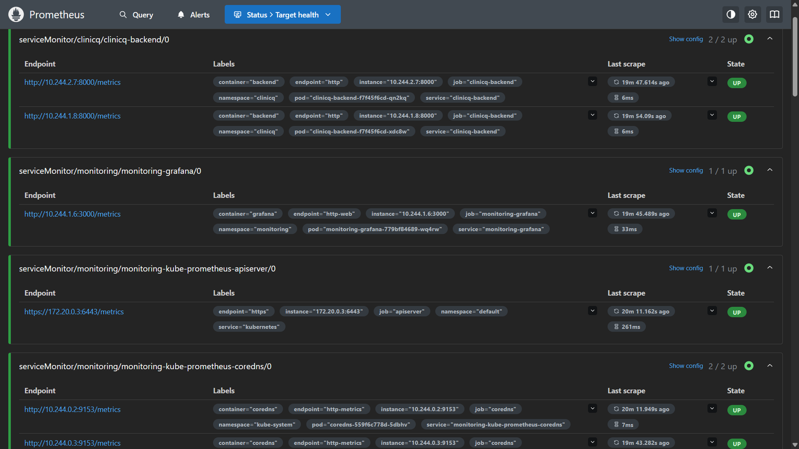

**Grafana** shows the **ClinicQ Overview** dashboard: appointments booked and cancelled, backend replicas, 5xx errors, request rate per endpoint and p95 latency, which settles near 50 ms.

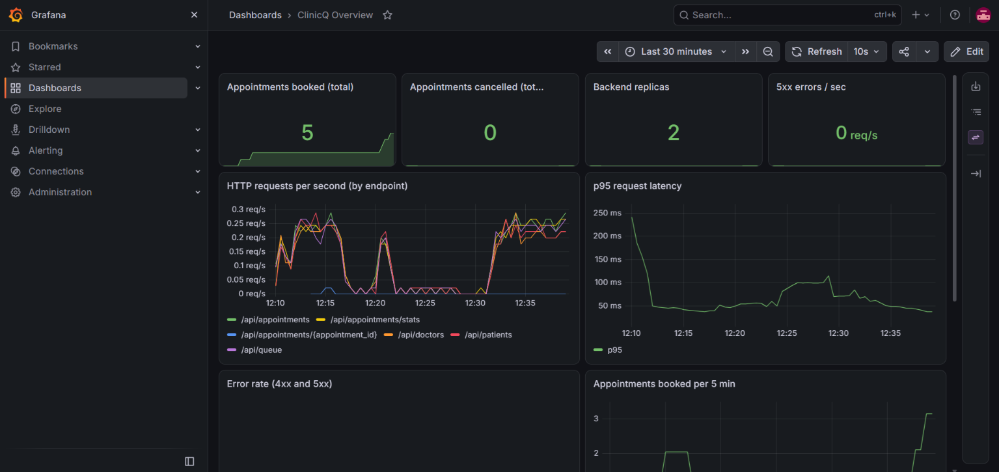

---

## 17. Troubleshooting labs

Two deliberately broken manifests live in [`troubleshooting/`](troubleshooting). Both use the same method: read the status, describe, compare, fix.

| Lab | Symptom | Diagnose | Fix |
|---|---|---|---|
| [`broken-image.yaml`](troubleshooting/broken-image.yaml) | Pod stuck in `ImagePullBackOff` | `kubectl get pods`, then `kubectl describe pod <pod>` shows the failed pull event | Correct the image tag and re-apply |
| [`broken-service.yaml`](troubleshooting/broken-service.yaml) | Pods `Running` but no traffic | `kubectl get endpoints` shows `<none>` | Make the Service selector match the pod labels |

---

## 18. Problems I hit and how I fixed them

| Problem | Cause | Fix |
|---|---|---|
| Pipeline turned red with no code change | A third-party Trivy action tag disappeared | Run the pinned official `aquasec/trivy` image directly |
| Trivy failed on HIGH findings | Libraries bundled inside `pip` | Remove `pip`, `setuptools` and `wheel` from the runtime image |
| Helm timed out on EKS | PostgreSQL volume `Pending`: no default StorageClass | Set an explicit storage class for the PostgreSQL volume |
| Commands failed on Windows | Bash syntax pasted into PowerShell | Git Bash for scripts, PowerShell syntax for the rest |

---

## 19. Cost control and clean-up

The platform was designed to fit a student budget:

- Nodes are **Spot** instances.
- **One NAT gateway** serves both private subnets.
- The deploy job runs only when `DEPLOY_ENABLED` is `true`, so ordinary pushes cost nothing.

Because everything is Terraform, the platform exists only while it is needed. Remove the Kubernetes load balancers first so Terraform can delete the VPC cleanly:

```bash
helm uninstall clinicq -n clinicq
kubectl delete pvc --all -n clinicq
helm uninstall ingress-nginx -n ingress-nginx
helm uninstall monitoring -n monitoring
# wait about two minutes for the AWS load balancers to disappear, then:
cd terraform && terraform destroy
```

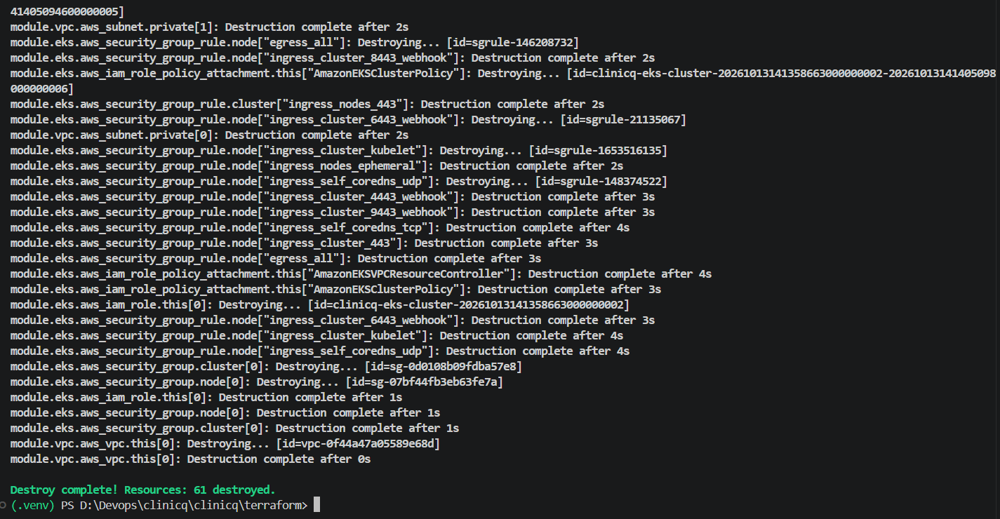

*`Destroy complete! Resources: 61 destroyed.` Nothing is left running or billing.*

---

## 20. Project structure

```
ClinicQ/
├── backend/               FastAPI app, Alembic migrations, tests, Dockerfile
├── frontend/              React + Vite app, nginx config, Dockerfile
├── terraform/             VPC and EKS
├── helm/clinicq/          Helm chart: backend, frontend, PostgreSQL, ingress, HPA
├── k8s/                   Namespace and StorageClass manifests
├── monitoring/            kube-prometheus-stack values and the Grafana dashboard
├── troubleshooting/       Two broken manifests for the debugging labs
├── scripts/               seed data, kind setup, load test
├── docs/                  Presentation, demo video and screenshots
├── .github/workflows/     ci-cd.yml
└── docker-compose.yml     Local run
```

---

## 21. Requirement map

| Area | Where to look |
|---|---|
| Application, API and database | [`backend/`](backend), [`frontend/`](frontend), [API](#6-api), [Data model](#7-data-model-and-database) |
| Automated tests | [Automated tests](#8-automated-tests) |
| Docker | [Containers](#9-containers), [`docker-compose.yml`](docker-compose.yml) |
| Git workflow | [Development workflow](#10-development-workflow) |
| CI/CD pipeline | [CI/CD pipeline](#11-cicd-pipeline), [`ci-cd.yml`](.github/workflows/ci-cd.yml) |
| Security scan | [Security scanning with Trivy](#12-security-scanning-with-trivy) |
| Container registry | [Images and tags](#images-and-tags) |
| Terraform on AWS | [Infrastructure with Terraform](#13-infrastructure-with-terraform) |
| Kubernetes and Helm | [Kubernetes with Helm](#14-kubernetes-with-helm) |
| Ingress and autoscaling | [Ingress, autoscaling and storage](#15-ingress-autoscaling-and-storage) |
| Monitoring | [Monitoring](#16-monitoring) |
| Troubleshooting | [Troubleshooting labs](#17-troubleshooting-labs) |
| Demo | [Demo video](docs/demo.mp4), [presentation](docs/ClinicQ-Capstone.pptx) |

---

<div align="center">

Built by **Samarth** for the DevOps Final Capstone.

</div>
